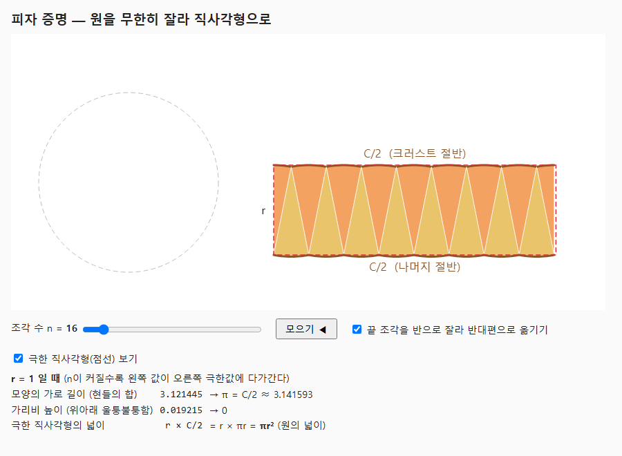

# 1. 피자 증명

- 책: 1장 Infinity › *A Pizza Proof* (원서 p.4–8, PDF p.30–34)
- 언어: JavaScript (p5.js)
- 실행: `pizza.html`을 브라우저로 열기
  - 바로 특정 상태로 열기: `pizza.html?n=16&t=1&spruce=1`

## 개념 한 줄

원을 n조각 내어 엇갈려 붙이면, n → ∞ 에서 **가로 C/2, 세로 r** 인 직사각형이 된다.
조각을 옮겨도 넓이는 그대로이므로 원의 넓이 = r × C/2 = πr².

## 볼 것

1. **n = 4 → 8 → 16 → 64**: 위아래 울퉁불퉁한 가리비가 납작해지고, 빨간 점선(극한 직사각형)에 달라붙는다.
2. **"끝 조각 반 잘라 옮기기"**: 평행사변형의 비스듬한 양끝이 수직이 된다. 책의 *spruce-up* 단계.
3. **표의 숫자**: 가로 길이 n·sin(π/n) 은 π로, 가리비 높이 1 − cos(π/n) 은 0으로 간다.
   어떤 유한한 n에서도 정확히 같아지지는 않는다 — 이것이 다음 절 *Limits* 의 "도달할 수 없는 목표".

## 구현 메모

- 조각 하나 = 꼭짓점 위치 + 중심축 각도 + 축 기준 각도 범위. 애니메이션은 이 세 값을 원래 자리 → 목표 자리로 보간한다.
- 위쪽 절반의 조각은 끝이 위로, 아래쪽 절반은 끝이 아래로 가서 서로 맞물린다.
  이웃한 조각의 반지름 변이 정확히 겹치도록 위 조각 꼭짓점 간격 = 현의 길이 2r·sin(π/n).
